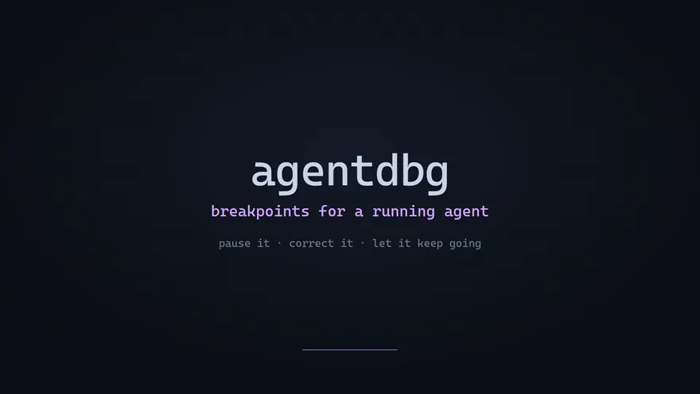

# agentdbg

[](https://github.com/Boughzala-ayoub/agentdbg/actions/workflows/ci.yml)

Breakpoints for a running agent.



A `PreToolUse` hook runs **synchronously** before every tool call, so blocking inside it
pauses the agent mid-run. That's the whole trick — this is a debugger, not a logger. Break
when it's about to write outside `src/`, look at what it's actually doing, fix its wrong
assumption, and let it continue.

Windows, macOS and Linux. Python 3.11 stdlib only. One file.

## Use

Run the file directly. If you install it as `agentdbg` later, you can use that shorter name.

```
python agentdbg.py install                      print the settings.json hook entry
python agentdbg.py guard                        arm defaults for this directory
python agentdbg.py watch                        tail every tool call, no pausing
python agentdbg.py stats                        summarize this project's trace
python agentdbg.py break "Write:!^.*/src/"      pause on writes outside src
python agentdbg.py deny "Bash:rm -rf " "why"    block outright, console or not
python agentdbg.py step                         pause on every call
python agentdbg.py run                          stop pausing on every call
python agentdbg.py rules                        show rules, scopes, and console state
python agentdbg.py attach                       open the console
```

`break`, `deny`, and `guard` scope new rules to the current directory. Rules without a
`cwd` field in `rules.json` apply to every project.

## Two kinds of rule

|  | needs a human? | with no console attached |
|---|---|---|
| `break` | yes — you decide per call | **fails open**: no pause, no delay |
| `deny` | no — it's policy | **fails closed**: still blocked |

That split is the whole design. A debugger you forgot to detach must never wedge your day,
so breakpoints evaporate when nobody's driving. A policy that evaporates when nobody's
watching is worthless, so deny rules don't.

`python agentdbg.py guard` arms both at once — destructive shell and force-push denied outright,
pushes/installs and writes outside the current directory paused for you:

```
$ python agentdbg.py guard
guarded: 2 deny rules, 2 breakpoints (writes outside /home/you/proj pause)

$ echo '{"cwd":"/home/you/proj","tool_name":"Bash","tool_input":{"command":"rm -rf /important"}}' | python agentdbg.py hook
{"hookSpecificOutput": {"permissionDecision": "deny",
 "permissionDecisionReason": "destructive shell command - do it yourself if you really mean it"}}
```

In the console, each paused call offers:

| key | |
|---|---|
| `c` | continue — emits **nothing**, so the normal permission flow is untouched |
| `d` | deny, and type why — the reason goes back to the model as feedback |
| `e` | edit the tool input in `$EDITOR`, resume with the edited version |
| `s` / `r` | step mode on / off |

`d` and `e` are the reason this beats a permission prompt: you're not just stopping the run,
you're correcting it without losing it.

## Fail-open, on purpose

A debugger you forgot to detach must never wedge your day, so:

- No breakpoint matches → the hook says nothing and exits (~60 ms, all of it Python startup).
- A breakpoint matches but **no console is attached** → straight through. The console writes a
  heartbeat every 0.3 s; older than 5 s counts as nobody driving.
- The console dies **while a call is paused** → the agent is released within 5 s.
- A pause has a hard 870 s ceiling regardless - just under the hook's own 900 s timeout,
  so agentdbg cleans up its handoff files instead of being killed holding them.

Fail-open is silent but not unrecorded: a break that fires with nobody attached is marked
`missed` in the trace, and `python agentdbg.py stats` counts them for this directory — so you learn what the console
would have caught. The console also rings the terminal bell when a call pauses.

Verified end to end: deny returns the right `permissionDecision`, edit returns `updatedInput`,
continue returns empty, and killing the console mid-pause releases the agent in 4.9 s.

## Cost

The hook spawns a Python process per tool call — about 60 ms. If that bothers you, narrow it
with a `matcher` (`"Write|Edit|Bash|PowerShell"`) or the `if` field (`"Bash(git *)"`) in the hook entry so
it isn't spawned for calls you'd never break on.

## Test

```
python test_agentdbg.py        # rules, matching, output shapes  (instant)
python test_protocol.py        # deny / edit / continue / console-dies, driving the real hook
python test_idle_console.py    # a console idle at the prompt must keep the pause alive
```

The last two spawn real processes and isolate themselves with `AGENTDBG_DIR`, which points
the state directory somewhere temporary. Without it a test's hook waits on the heartbeat of
*your* live console and hangs instead of failing — set it yourself if you ever want a second,
isolated console.

State lives in `%LOCALAPPDATA%\agentdbg` on Windows and `$XDG_STATE_HOME/agentdbg`
(default `~/.local/state/agentdbg`) elsewhere. Keypresses use `msvcrt` on Windows and raw
`termios` on macOS/Linux, falling back to line input when stdin isn't a tty.

## Limits

Claude Code only — `PreToolUse` is the interception point. One console at a time; the pending
queue is FIFO across sessions, so two paused agents queue up rather than showing side by side.
`updatedInput` is trusted as-is: if you edit a `file_path` into something invalid, the tool
fails the way it normally would.
